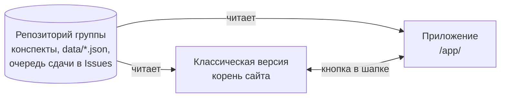

<div align="center">


# М3102

**Сайт группы М3102 (ИТМО, 1 курс): расписание, домашние задания, дедлайны, конспекты и материалы.**

[Сайт](https://redstonelord.github.io/itmo-m3102/) · [Приложение (/app/)](https://redstonelord.github.io/itmo-m3102/app/) · [Репозиторий группы](https://github.com/RedstoneLord/itmo-m3102)

</div>

## Содержание

[Две версии сайта](#две-версии-сайта) · [Что есть в каждой](#что-есть-в-каждой) · [Расписание и домашние задания](#расписание-и-домашние-задания) · [Диаграммы в конспектах](#диаграммы-в-конспектах) · [Ограничения](#ограничения) · [Как это устроено](#как-это-устроено) · [Запуск](#запуск) · [Структура репозитория](#структура-репозитория) · [Публикация](#публикация) · [Документация](#документация)

## Две версии сайта

У сайта две версии с общими данными. Расписание, ДЗ, дедлайны, ссылки, мемы и конспекты обе берут из этого
репозитория; личные отметки хранятся в браузере. Переключаются кнопкой в шапке.

| | Классическая версия | Приложение |
|---|---|---|
| Адрес | [корень сайта](https://redstonelord.github.io/itmo-m3102/) — открывается первой | [/app/](https://redstonelord.github.io/itmo-m3102/app/) |
| Технологии | статический сайт без сборки: HTML, CSS, ES-модули | React, TypeScript, Vite |
| Где в репозитории | корень: `index.html`, `css/`, `js/`, `data/` | папка [`app/`](app/README.md) |
| Тесты | `npm test` в корне | юнит-тесты и тесты в браузере в `app/` |

Обе версии работают без сервера и регистрации, на компьютере и телефоне.

## Что есть в каждой

| Раздел | Классическая версия | Приложение |
|---|---|---|
| **Расписание** | неделя и день, чётные и нечётные недели, аудитории и преподаватели; редактор расписания («Изменить», «Только этот день») | день, неделя сеткой по часам, месяц; переносы и замены; подписка на календарь `m3102.ics` для Google и Apple |
| **Домашние задания** | ДЗ группы к парам со сроком, отметка «сделано», сохранение в GitHub | те же ДЗ, отметки «сделано» из классической версии подхватываются сами; видны у пары и на странице предмета |
| **Дедлайны** | карточки сроков, очередь на сдачу через GitHub Issues, «выполнено для меня» | те же сроки и очередь, профиль студента по нажатию на имя |
| **Конспекты** | Markdown с формулами и подсветкой кода, PDF по страницам, печать, боковая панель лекций | предмет → занятие, оглавление, закладки и пометки, PDF с тёмными страницами и «продолжить с места», «Скачать PDF» |
| **Схемы** | блоки `graph`, `plot`, `chart`, `tree`, `array`, `diagram`, `canvas`; пошаговое выполнение кода над массивом; редактор на странице «Диаграммы» | те же блоки и редактор схем |
| **Тесты** | интерактивные тесты в конспектах | тесты к конспектам, повторение ошибок, режим «Перед контрольной» |
| **Поиск** | по тексту конспектов (клавиша `/`) | `Ctrl+K`: конспекты и PDF, предметы, дедлайны, быстрые действия |
| **Личное** | «Мой учебный план» | учебный план, заметки, результаты тестов |
| **Группа** | студенты, полезные ссылки, мемы | студенты, ссылки, файлы репозитория группы, мемы |
| **Без интернета** | кэш конспектов и данных | установка как приложение; PDF и картинки заранее на устройство |
| **Для ИИ** | — | все конспекты предмета одним Markdown-файлом или ссылкой |
| **Оформление** | тёмное или светлое по системе, живой фон | стили Minimalism, Aurora, Liquid Glass; светлая, тёмная или системная тема; палитра акцентов |
| **Игры** | «Ёжик-кувырок», казино («Колючий куш», блэкджек, рулетка, коллекция), ёжик на главной | те же игры в своих версиях, ёжик на главной |

Тема, палитра и скругления общие: поменяли в одной версии — при следующем открытии то же в другой.

## Расписание и домашние задания

Кнопки редактирования расписания и публикации ДЗ ниже относятся к классической версии. В приложении редакторские действия включаются только сборкой с `VITE_EDITING=true`; личные отметки «сделано» доступны всегда.

В расписании выберите день, откройте карточку пары, добавьте домашнее задание. Срок по умолчанию — следующая пара по этому предмету с учётом каникул и разовых изменений. В тексте ДЗ работают `**жирный**`, `*курсив*`, `код`, списки с `-`, ссылки `https://…` и формулы `$…$`. На странице «Домашнее задание» можно видеть все актуальные, выполненные или все задания. Отметка «сделано» личная: она остаётся в `localStorage` и не публикуется.

Кнопка «Изменить» открывает редактор расписания. Режим «Только этот день» создаёт запись в `overrides`; режим «Общее расписание» меняет один день 14-дневного цикла. Изменения сначала становятся локальным черновиком. Без токена JSON можно скачать, скопировать или открыть в веб-редакторе GitHub.

Чтобы сохранить расписание или ДЗ для всей группы:

1. Откройте [настройки GitHub fine-grained PAT](https://github.com/settings/personal-access-tokens/new).
2. Выберите только репозиторий `RedstoneLord/itmo-m3102` и право **Contents: Read and write**. Создайте токен с коротким сроком действия.
3. Нажмите «Сохранить в GitHub» на сайте, вставьте токен и проверьте сообщение коммита. Чекбокс «Запомнить» хранит токен в `localStorage`; без него токен живёт только в текущей вкладке (`sessionStorage`). На общем компьютере не включайте этот чекбокс.

Публикация предназначена для участников с правом записи в репозиторий: токен сам доступа не выдаёт. Без такого права скачайте JSON или предложите изменения через GitHub; для чтения материалов и личных отметок токен не нужен.

Токен не передаётся в адресе страницы и не включается в JSON. Кнопка «Забыть токен» находится в окне публикации расписания. Публикация использует GitHub Contents API и проверяет SHA удалённого файла. Для ДЗ локальные изменения сливаются с удалёнными по `id`; для расписания при конфликте предлагается применить только свои изменения поверх новой версии.

## Диаграммы в конспектах

Добавьте fenced-блок в `.md` конспект. Сайт сам построит SVG. Тип блока: `graph`, `plot`, `chart`, `tree`, `array`, `diagram` или `canvas`. Общие строки: `title:`, `caption:`, `width:`, `height:`. Комментарии начинаются с `#` или `//`.

````markdown
```graph
graph directed
layout: circle
A -> B : 5
B -> C : 2 {color: red}
A @ 120,80
```

```plot
plot
x: -5..5 y: -3..3 grid
y = sin(x) {color: blue, label: "sin x"}
y = x^2/4 - 1
(cos(t), sin(t)) t: 0..2*pi
point (1, 2) "A"
area y = x^2 from 0 to 2
tangent y = x^2 at 1
```

```chart
chart bar
title: Баллы
series: Тест | Экзамен
ДМ | 78 | 91
Алгебра | 72 | 88
```

```tree
tree
Корень
  Левый
  Правый
```

```array
array
[5, 2, 9, 1, 7] i=1 j=3 highlight: 2,3 sorted: 0
```

```diagram
diagram
A: round "Старт"
B: diamond "Условие"
C: box "Действие"
A -> B
B -> C
```

```canvas
canvas 400x200
rect 20 20 120 60 "Вход" fill=#eef
arrow 140 50 -> 220 50
circle 260 50 r=30 "q0"
text 20 150 "Подпись"
```
````

Для графа доступны `circle`, `grid`, `layered`, `force`, `manual`, ориентированные `->` и обычные `--` рёбра. Для `chart` доступны `bar`, `line`, `pie`, `scatter`. Для `array` — варианты `linked`, `stack`, `queue`. Цвета ограничены палитрой (`red`, `blue`, `green`, `purple`, `orange`, `gray`, `black`, `white`) или шестнадцатеричным `#rgb`/`#rrggbb`. Графики поддерживают `+ - * / ^`, скобки, неявное умножение, `pi`, `e`, `x`, `t` и функции `sin`, `cos`, `tan`, `sqrt`, `abs`, `log` и другие из подсказки редактора.

Страница «Диаграммы» содержит визуальный холст, текст DSL и превью. Вершины графа и блок-схемы перетаскиваются, граф можно дополнить вершинами и рёбрами, в том числе протягиванием между вершинами. Кнопка «Импорт» принимает список рёбер (`A B 5`) или матрицу смежности: первая строка — имена вершин через пробел, затем квадратная таблица чисел, где ноль означает отсутствие ребра. Фигуры холста тоже перетаскиваются. Для других языков есть структурные поля. Доступны отмена/повтор, SVG/PNG, Markdown-блок, ссылка с исходником и сохранение картинки в репозиторий. SVG сохраняется с разрешёнными цветами темы; PNG экспортируется с масштабом ×2. При сохранении PNG в репозиторий можно выбрать фон.

## Ограничения

Диаграммы рассчитаны на учебные примеры до 500 элементов, графики — до 4000 точек. В редакторе сохранение SVG/PNG идёт напрямую в выбранную папку репозитория и требует токена; без токена используйте скачивание. Текст DSL остаётся источником данных: произвольные комментарии сохраняются при точечных правках, но редактирование выбранной строки может заменить её форматирование.

У проекта нет собственного backend. Аккаунты, синхронизация личных данных между устройствами и уведомления сейчас не реализованы: общие учебные данные хранятся в GitHub, личные — в браузере. План backend со входом через ITMO ID — в [docs/BACKEND_PLAN.md](docs/BACKEND_PLAN.md).

## Как это устроено



- **Данные** обе версии читают из репозитория группы по сети. Список файлов запрашивается один раз, сами файлы берутся с `raw.githubusercontent.com`, поэтому новые конспекты видны вскоре после сохранения.
- **Личное** (отметки, заметки, учебный план, результаты тестов) лежит в `localStorage` браузера и никуда не отправляется. Пароли ИТМО сайт не принимает.
- **Запись в репозиторий** (расписание, ДЗ, мемы) идёт через токен GitHub с правом на один репозиторий; токен хранится только в браузере.
- **Переключение** между версиями — общий скрипт [`app/public/switch/site-switch.js`](app/public/switch/site-switch.js), который подключают обе. Подробности — в [AGENTS.md](AGENTS.md).

## Запуск

Классическая версия запускается без сборки:

```bash
python3 -m http.server 8000
# открыть http://localhost:8000/
npm test        # тесты классической версии
```

Сайт использует ES-модули и `fetch`, поэтому открывать `index.html` через `file://` нельзя. Данные лежат в `data/schedule.json` и `data/homework.json`.

Приложение (нужен Node.js 22.12 или новее — так требует Vite; CI работает на Node.js 22):

```bash
cd app
npm install
npm run dev          # http://localhost:5173, классическая версия — на /classic/
npm test             # юнит-тесты
npm run test:e2e     # тесты в браузере по собранному сайту
npm run build
```

Все команды и проверки приложения — в [app/README.md](app/README.md).

## Структура репозитория

```text
.
├── index.html, site.css, css/, js/, img/    классическая версия
├── data/, Дедлайны/                          данные группы: расписание, ДЗ, ссылки, мемы, сроки
├── tests/                                    тесты классической версии
├── app/                                      приложение (React)
│   ├── src/, public/, e2e/, scripts/         код, статика, тесты в браузере, сборка сайта
│   └── README.md                             описание приложения
├── docs/                                     документы (план сервера)
├── AGENTS.md, CLAUDE.md                      правила и устройство кода для разработчиков
└── .github/                                  автоматизация
```

Конспекты, материалы и записи лекций лежат в репозитории группы, обе версии читают их оттуда.

## Публикация

Сайт выкладывает GitHub Actions при пуше в `master` и раз в сутки: проверки и сборка приложения, затем одна папка
`app/site`, где классическая версия лежит в корне, а приложение — в `/app/`. Исходники классической версии при
сборке не меняются. В её собранную копию добавляется общий переключатель, удаляется PWA-манифест и нормализуется список скрытых
служебных файлов (`app/src/lib/classicPatch.ts`). Локально то же самое:

```bash
cd app
npm run build
npm run site          # app/site; -- --fresh подтянет свежие data/ и Дедлайны/
```

Изменения на GitHub Pages появляются через несколько минут после пуша.

## Документация

- [app/README.md](app/README.md) — приложение: разделы, оформление, данные, команды, устройство кода.
- [AGENTS.md](AGENTS.md) — правила и решения для разработчиков: ветки, CI, дизайн, скорость, офлайн.
- [docs/BACKEND_PLAN.md](docs/BACKEND_PLAN.md) — план сервера со входом через ITMO ID.

Спасибо всем, кто пишет конспекты, и [RedstoneLord](https://github.com/RedstoneLord/itmo-m3102) за сайт группы.
